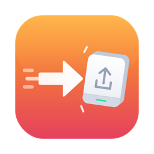
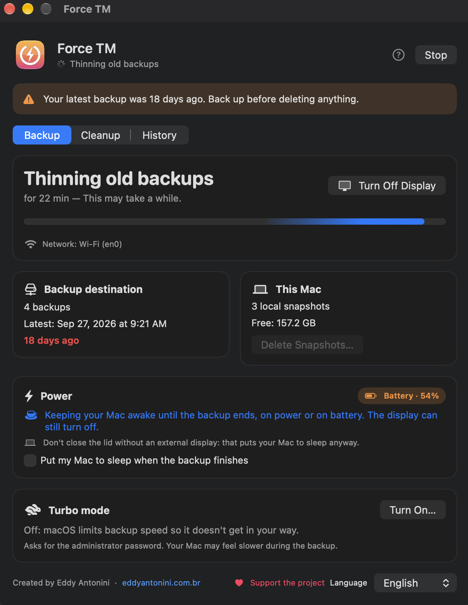

<p align="center"></p>

<h1 align="center">Force TM</h1>

<p align="center">
  <b>Un panel amigable para forzar, seguir y confirmar backups de Time Machine en macOS — y liberar espacio con seguridad.</b><br>
  <a href="README.md">English</a> · <a href="README.pt-BR.md">Português</a>
</p>

<p align="center"></p>

---

## Qué hace

- **Hacer backup ahora** — inicia un backup de Time Machine y mantiene el Mac despierto *solo mientras se ejecuta* (con corriente o con batería). La pantalla puede seguir apagándose y hay un botón **Apagar la pantalla**.
- **Progreso real** — el mismo porcentaje del menú de Time Machine, más enviados, analizados, velocidad, tiempo restante, Wi-Fi o cable, y fases sin porcentaje (como “Limpiando backups antiguos”) mostradas con claridad.
- **Resultado confirmado** — compara la lista de backups del destino antes y después: ✅ solo cuando realmente existe un backup nuevo; ❌ con el último backup bueno y los errores de Time Machine, si no.
- **Dormir al terminar (opcional)** — el Mac se duerme 30 s después del final del backup (se puede cancelar).
- **Snapshots locales** — mira cuántos hay y elimínalos para recuperar el espacio al instante.
- **Modo turbo** — quita temporalmente el límite de velocidad que macOS impone a Time Machine; vuelve a la normalidad solo al terminar el backup.
- **Limpieza** — multimedia de WhatsApp para Mac (por antigüedad) y cachés grandes (navegadores, Gradle, Xcode, Homebrew, npm, pip, modelos de IA…).
- **Icono en la barra de menús**, **aviso de backup atrasado**, **historial** y **ayuda** integrada.
- En **español, portugués e inglés**.

Toda acción que elimina archivos muestra un aviso y pide que escribas una palabra de confirmación.

## Descarga

Descarga el `.dmg` firmado y notarizado más reciente en **[Releases](https://github.com/lordironballs/force-tm/releases)**, ábrelo y arrastra **Force TM** a Aplicaciones.

Requiere **macOS 14 Sonoma o posterior**.

Al abrirlo por primera vez, activa el **Acceso total al disco** para Force TM (Ajustes del Sistema › Privacidad y seguridad › Acceso total al disco) para que pueda leer la lista de backups y la carpeta de WhatsApp.

## Compilar desde el código

Necesitas Xcode o las Command Line Tools (`xcode-select --install`).

```bash
git clone https://github.com/lordironballs/force-tm.git
cd force-tm
./build.sh
```

La app se compila, se instala en `~/Applications/Force TM.app` y se abre.

## ¿Por qué no está en la Mac App Store?

Las apps de la App Store se ejecutan en sandbox, que bloquea lo que Force TM necesita: ejecutar `tmutil`, Acceso total al disco, acciones de administrador (eliminar snapshots, modo turbo) y limpiar carpetas de otras apps. Por eso se distribuye aquí, firmado y notarizado por Apple.

## Seguridad

Force TM usa solo herramientas de Apple (`tmutil`, `pmset`, `sysctl`). Nunca ve ni guarda tu contraseña — macOS la pide directamente. Eliminar snapshots locales, multimedia de WhatsApp o cachés no se puede deshacer: mantén tus backups al día. Se ofrece tal cual, sin garantías (ver [LICENSE](LICENSE)).

## Apoya

Force TM es gratuito. Si te ayudó, una donación de agradecimiento ayuda a mantener el proyecto ❤️

- 🇧🇷 **PIX:** `pix@xwa.com.br` (o usa **Apoyar el proyecto** dentro de la app para ver el código QR)
- 🌎 **[GitHub Sponsors](https://github.com/sponsors/lordironballs)**
- ⭐ ¡Dar una estrella al repositorio y recomendar la app también ayuda mucho!

## Licencia

[MIT](LICENSE) © 2026 [Eddy Antonini](https://eddyantonini.com.br)
